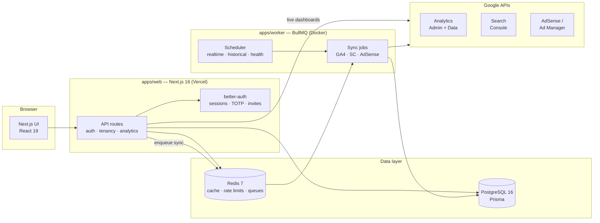
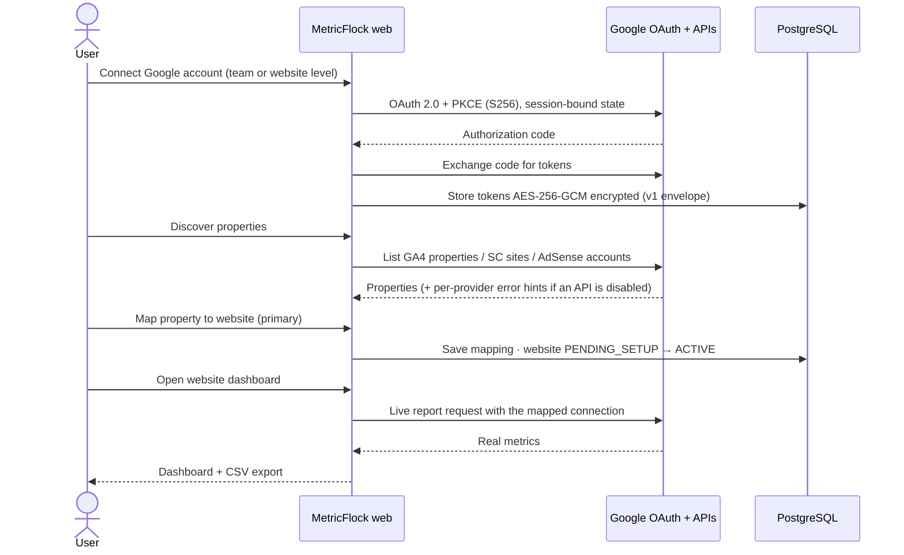
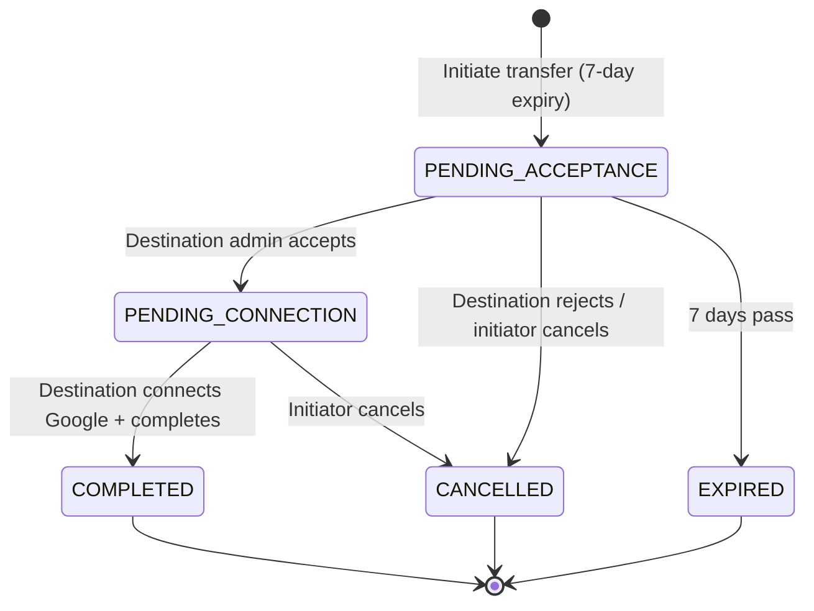

<div align="center">


# MetricFlock

**Multi-website Google Analytics & publisher management — GA4, Search Console, AdSense and Ad Manager across 100+ websites, in one place.**

[](https://github.com/zuhandeveloper/metricflock/actions/workflows/ci.yml)
[](https://github.com/zuhandeveloper/metricflock/actions/workflows/codeql.yml)
[](https://github.com/zuhandeveloper/metricflock/actions/workflows/security-audit.yml)
[](https://github.com/zuhandeveloper/metricflock/actions/workflows/lint.yml)


🌐 **Live:** [metricflock.bond](https://metricflock.bond)

</div>

---

## Table of contents

- [Overview](#overview)
- [Features](#features)
- [Architecture](#architecture)
- [How it works](#how-it-works)
- [Website ownership transfers](#website-ownership-transfers)
- [Roles & permissions](#roles--permissions)
- [Tech stack](#tech-stack)
- [Repo layout](#repo-layout)
- [Quick start](#quick-start)
- [Scripts](#scripts)
- [Environment variables](#environment-variables)
- [Security](#security)
- [Testing & CI](#testing--ci)
- [Documentation](#documentation)
- [Project status](#project-status)
- [License](#license)

## Overview

MetricFlock is a multi-tenant platform for people who run many websites —
publishers, agencies and site flippers. Instead of logging into Google
Analytics, Search Console and AdSense separately for every property, you
connect each Google account once and get one dashboard per organization,
team and website.

- **Organizations → Teams → Websites** — three-level tenancy with granular,
  role-based permissions.
- **Real Google APIs only** — GA4 Data/Admin, Search Console, AdSense and
  Ad Manager via `googleapis`. No mock data anywhere: when nothing is
  connected, the API says so explicitly (`not_connected` / `missing_data`).
- **Team- or website-level Google OAuth** — connect one Google account for a
  whole team, or a dedicated account per website. Tokens are encrypted at
  rest with AES-256-GCM.
- **Website flipping built in** — a two-sided ownership transfer flow moves a
  website between teams/organizations only after the receiving side accepts
  and connects its own Google account.
- **Background sync** — BullMQ workers keep snapshots fresh (realtime,
  historical, Search Console, AdSense) with a dead-letter queue and
  failure alerts.

## Features

| Area                 | What's included                                                                                          |
| -------------------- | -------------------------------------------------------------------------------------------------------- |
| **GA4**              | Realtime totals + platform breakdown, historical summary, top pages, sampling flags surfaced in the UI   |
| **Search Console**   | Clicks, impressions, CTR, impression-weighted average position, top queries & pages (paginated)          |
| **AdSense**          | Estimated earnings, page views, impressions, clicks, CTR, CPC, page RPM, impression RPM                  |
| **Ad Manager**       | Optional integration for ad reporting (**beta** — not yet verified against a live network)               |
| **Discovery**        | One click lists every GA4 property, Search Console site and AdSense account a connection can see         |
| **Property mapping** | Map discovered properties to websites; first mapping flips a website from `PENDING_SETUP` to `ACTIVE`    |
| **Teams & members**  | Invite flow (email invites join the inviter's org with the invited role), role changes, last-admin guard |
| **Transfers**        | Two-sided website ownership transfer with acceptance, expiry and audit trail                             |
| **Dashboards**       | Organization, team and website views with CSV export on analytics routes                                 |
| **Sync engine**      | Scheduled + on-demand sync jobs, retries, DLQ list/requeue, email alerts on terminal failures            |
| **Audit log**        | Every sensitive action recorded with actor, IP and request ID; credentials scrubbed recursively          |
| **Account security** | Email verification, password reset with session revocation, TOTP two-factor, session management          |

## Architecture



Dashboards read **live** from Google through the web app; the worker keeps
stored snapshots fresh in the background and is only needed for scheduled
sync — the app works without it (manual "Sync now" returns `503
queue_unavailable` until Redis is configured).

## How it works



## Website ownership transfers

Transfers are **two-sided**: the receiving team must accept, and the website
only moves once the destination has its own active Google connection — so a
site is never handed over without working data access.



Completing a transfer moves the website to the destination team and clears
the previous team's assignments and integrations. Only one open transfer per
website is allowed (enforced by a partial unique index).

## Roles & permissions

Three roles, 17 granular permissions (`packages/auth/src/permissions.ts`):

| Capability                              | SUPER_ADMIN | TEAM_ADMIN | TEAM_MEMBER |
| --------------------------------------- | :---------: | :--------: | :---------: |
| View analytics, Search Console, AdSense |     ✅      |     ✅     |     ✅      |
| View GA4 realtime                       |     ✅      |     ✅     |     ❌      |
| Manage websites & assignments           |     ✅      |     ✅     |     ❌      |
| Manage teams                            |     ✅      |     ✅     |     ❌      |
| Manage members & invites                |     ✅      |     ✅     |     ❌      |
| Manage Google connections               |     ✅      |     ✅     |     ❌      |
| Transfer websites                       |     ✅      |     ❌     |     ❌      |
| View audit log                          |     ✅      |     ❌     |     ❌      |
| Manage organization                     |     ✅      |     ❌     |     ❌      |

Self sign-ups get their own organization as SUPER_ADMIN; invited users join
the inviter's organization with the role on their invite (SUPER_ADMIN is
never grantable by invite).

## Tech stack

| Layer       | Technology                                                                 |
| ----------- | -------------------------------------------------------------------------- |
| Web app     | Next.js 16, React 19, TypeScript 7, Tailwind CSS 4                         |
| Auth        | better-auth (email + password, Google sign-in, TOTP 2FA)                   |
| Database    | PostgreSQL 16, Prisma 7                                                    |
| Queue/cache | Redis 7, BullMQ                                                            |
| Google APIs | `googleapis` (Analytics Admin/Data, Search Console, AdSense, Ad Manager)   |
| Monorepo    | pnpm workspaces + Turborepo                                                |
| Testing     | Vitest (unit, coverage-gated), Playwright + axe (e2e), bash smoke suite    |
| CI          | GitHub Actions — SHA-pinned actions, gitleaks, CodeQL, Semgrep, Dependabot |

## Repo layout

```
apps/web/         Next.js 16 app — routes, pages, components (src/app, src/components)
apps/worker/      BullMQ worker — long-running Node process (Dockerfile included)
packages/db/      Prisma schema, migrations, client, seed
packages/auth/    better-auth config, sessions, tenancy, permissions, mailer
packages/google/  GA4, Search Console, AdSense, Ad Manager clients + OAuth
packages/jobs/    BullMQ queues, sync intervals, job bookkeeping
packages/shared/  Env validation, cache, crypto, validation, rate limiting, logging
docs/             Product, security, operations, testing and setup guides
scripts/          Smoke test, boundary checks, backup/restore
```

The canonical `.env` lives in `apps/web/` — see `docs/env-config.md`.

## Quick start

**Requirements:** Node.js ≥ 26, pnpm 12.21.0 (`corepack prepare pnpm@12.21.0 --activate`),
PostgreSQL 16 + Redis 7 (or `docker compose up -d`).

```bash
cp apps/web/.env.example apps/web/.env   # fill in DATABASE_URL, SESSION_SECRET,
                                         # GOOGLE_TOKEN_ENCRYPTION_KEY, Google OAuth creds
docker compose up -d                     # Postgres + Redis
pnpm install
pnpm db:migrate                          # apply Prisma migrations
pnpm db:seed                             # demo@example.com / ChangeMe123! — CHANGE IT
pnpm dev                                 # web app on http://localhost:3000
pnpm worker                              # background sync worker (needs Redis)
```

Then connect a Google account from **Integrations**, run **Discover**, map a
property to a website, and open the website dashboard. Google Cloud setup
(which APIs to enable, redirect URIs) is covered in
`docs/google-cloud-setup.md` and `docs/api-enablement.md`.

## Scripts

| Command                                   | What it does                                                         |
| ----------------------------------------- | -------------------------------------------------------------------- |
| `pnpm dev`                                | Run the web app in development                                       |
| `pnpm build`                              | Build all packages and apps (Turborepo)                              |
| `pnpm check`                              | Format check + lint + typecheck + unit tests                         |
| `pnpm test` / `test:coverage`             | Unit tests (coverage thresholds enforced in CI)                      |
| `pnpm smoke`                              | End-to-end smoke suite against real Postgres + Redis (needs a build) |
| `pnpm --filter @metricflock/web test:e2e` | Playwright + axe accessibility tests (needs a build)                 |
| `pnpm db:migrate`                         | Apply database migrations                                            |
| `pnpm db:seed`                            | Seed the demo admin (development only)                               |
| `pnpm db:studio`                          | Open Prisma Studio                                                   |
| `pnpm worker`                             | Run the BullMQ sync worker                                           |
| `pnpm format`                             | Format the repo with Prettier                                        |

## Environment variables

The full list with explanations is in `docs/env-config.md`. The essentials:

| Variable                                    | Purpose                                                  |
| ------------------------------------------- | -------------------------------------------------------- |
| `DATABASE_URL`                              | PostgreSQL connection string                             |
| `SESSION_SECRET`                            | Session signing secret (≥ 32 chars)                      |
| `GOOGLE_TOKEN_ENCRYPTION_KEY`               | Base64 of 32 bytes — encrypts stored Google OAuth tokens |
| `GOOGLE_TOKEN_ENCRYPTION_KEY_PREVIOUS`      | Previous key during a rotation window (optional)         |
| `GOOGLE_CLIENT_ID` / `GOOGLE_CLIENT_SECRET` | Google OAuth client                                      |
| `GOOGLE_REDIRECT_URI`                       | OAuth callback URL                                       |
| `NEXT_PUBLIC_APP_URL`                       | Public app URL                                           |
| `REDIS_URL`                                 | Redis for queues, cache and rate limiting                |
| `SMTP_*`                                    | Outgoing mail (verification, resets, failure alerts)     |
| `SYNC_*`                                    | Sync intervals (GA4 realtime, health checks, …)          |

> ⚠️ The encryption key must be **identical** everywhere the app runs against
> the same database — tokens encrypted with one key cannot be decrypted with
> another. Rotation procedure: `docs/token-encryption-rotation.md`.

## Security

- **OAuth hardening** — S256 PKCE, single-use session-bound state stored
  server-side, timing-safe HMAC comparison, per-connection refresh locks;
  only a structured `invalid_grant` revokes a connection.
- **Token encryption** — versioned AES-256-GCM envelope (`v1:<keyId>:…`)
  with the connection identity as AAD, key-rotation window and lazy
  re-encryption; auth tag length pinned to 16 bytes.
- **Tenant isolation** — every query is organization-scoped; cross-tenant
  IDOR probes run in the CI smoke suite.
- **Audit logging** — sensitive actions recorded with actor, IP and request
  ID; credential-looking fields scrubbed recursively.
- **Supply chain** — GitHub Actions pinned by commit SHA (Dependabot keeps
  them current), `minimumReleaseAge` age gate on new package versions,
  gitleaks secret scanning, CodeQL + Semgrep SAST, `pnpm audit` gate.
- **Hardening history** — a 9-stage production-readiness program (93 audit
  findings) is documented in `docs/audits/PRODUCTION_READINESS_AUDIT.md` and
  `docs/security/overview.md`. Vulnerability reports: see `SECURITY.md`.

## Testing & CI

Every push to `main` runs the full pipeline:

| Workflow                  | What it checks                                                                                                                                                  |
| ------------------------- | --------------------------------------------------------------------------------------------------------------------------------------------------------------- |
| **CI**                    | gitleaks, `pnpm audit`, format, typecheck, lint, unit tests with coverage, build, smoke suite (real Postgres + Redis), Playwright/axe e2e, backup-restore drill |
| **CodeQL**                | Static analysis for JavaScript/TypeScript                                                                                                                       |
| **Security audit**        | Semgrep (`p/typescript`) over `apps/` and `packages/`                                                                                                           |
| **Lint**                  | Markdown trailing-whitespace and YAML validity                                                                                                                  |
| **Scheduled maintenance** | Weekly `pnpm audit`                                                                                                                                             |
| **Label**                 | Auto-labels PRs by changed paths (`.github/labeler.yml`)                                                                                                        |
| **Release**               | Creates a GitHub release with generated notes on `v*` tags                                                                                                      |

Unit tests use mocked Google clients and are labelled as such; route-level
authorization and the full auth/transfer/OAuth matrix are proven by the smoke
suite against real infrastructure. See `docs/testing/README.md`.

## Documentation

| Guide                                                                    | Topic                                     |
| ------------------------------------------------------------------------ | ----------------------------------------- |
| [`docs/product/overview.md`](docs/product/overview.md)                   | Product overview                          |
| [`docs/google-cloud-setup.md`](docs/google-cloud-setup.md)               | Google Cloud project + OAuth client setup |
| [`docs/api-enablement.md`](docs/api-enablement.md)                       | Which Google APIs to enable               |
| [`docs/oauth-guide.md`](docs/oauth-guide.md)                             | OAuth connect flow                        |
| [`docs/property-mapping.md`](docs/property-mapping.md)                   | Mapping discovered properties to websites |
| [`docs/team-management.md`](docs/team-management.md)                     | Teams, members and invites                |
| [`docs/website-management.md`](docs/website-management.md)               | Websites and assignments                  |
| [`docs/ownership-transfer.md`](docs/ownership-transfer.md)               | Website ownership transfers               |
| [`docs/security/overview.md`](docs/security/overview.md)                 | Security architecture                     |
| [`docs/token-encryption-rotation.md`](docs/token-encryption-rotation.md) | Rotating the token encryption key         |
| [`docs/operations/observability.md`](docs/operations/observability.md)   | Logs, metrics, health endpoints, DLQ      |
| [`docs/operations/backup-restore.md`](docs/operations/backup-restore.md) | Backup & restore runbook                  |
| [`docs/deployment.md`](docs/deployment.md)                               | Deployment (Vercel + worker)              |
| [`docs/env-config.md`](docs/env-config.md)                               | Environment variables                     |
| [`docs/testing/README.md`](docs/testing/README.md)                       | Testing strategy                          |
| [`docs/troubleshooting.md`](docs/troubleshooting.md)                     | Common problems and fixes                 |

## Project status

- ✅ Google sign-in verified in production (2026-11-21).
- ✅ **Live Search Console data verified** against a real connected account in
  production (2026-11-21) — dashboard numbers matched the Search Console UI.
- 🔄 GA4 reports run on the REST Data API client; final live-data
  confirmation in progress. AdSense discovery is verified; earnings report
  verification is pending.
- 🔄 The background worker is deploy-ready (Dockerfile included) but not yet
  hosted in production — dashboards work without it.
- 🧪 Everything above the data layer is covered by unit tests plus the CI
  smoke suite against real Postgres + Redis on every push.

## License

[MIT](LICENSE) © 2026 Zuhan Zaheer
