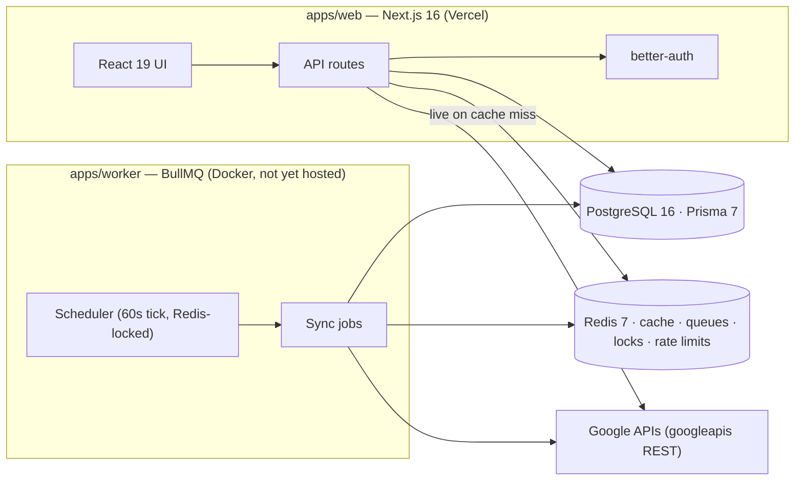

# Architecture Review — 2026-11-21 (main @ `810faea5`)

## System shape

Monorepo (pnpm workspaces + Turborepo): `apps/web`, `apps/worker`,
`packages/{db,auth,google,jobs,shared}`. Package boundaries are enforced
by `scripts/check-boundaries.sh` (Google SDK only in `packages/google`,
Prisma client only in `packages/db`, no `console.*` in src).

## Tenancy & authorization model (as implemented)

- **Organization** is the tenant boundary. Every query is org-scoped;
  foreign ids return 404. Composite same-org FKs in the schema back this
  at the DB layer for Website↔Team and connection owners.
- **Roles:** `SUPER_ADMIN` (org-wide), `TEAM_ADMIN`, `TEAM_MEMBER` +
  `TeamMember.isAdmin` (per-team admin flag) + `WebsiteAssignment`
  (per-website view grant). 17 permissions in
  `packages/auth/src/permissions.ts`.
- **Two access tiers** exist in `tenant.ts`: visibility
  (`assertWebsiteAccess` — assignment suffices) and management
  (`assertWebsiteManageAccess` — `isAdmin` of the owning team required).
  The gap between them is where F-1.1/F-1.2 live: mutating routes must
  use the management tier consistently.
- **Connection visibility** (`connectionVisibilityWhere` /
  `assertConnectionVisible`) scopes Google connections to org admins and
  admins of the owning team — applied on list/discover/disconnect, but
  not yet on property mapping (F-1.3).

## Data path

Dashboards are **cache-aside**: Redis hit → serve; miss → single-flight
lock → live Google call → cache. The worker writes the same Redis keys
on schedule, so warm dashboards rarely call Google, but there is no
durable snapshot store (`AnalyticsCache` table exists, unused). Freshness
is labeled honestly (`live`/`cached`/`stale`). Moving to
snapshot-first reads (brief Phase 5.1) is an architectural change, not a
bug fix — it needs the worker hosted in production first.

Cache keys: `analytics:{org}:{website}:{property}:{source}:{report}:{range}:{filters}`
— tenant-safe by construction; SCAN invalidation; no `KEYS` in hot paths.

## Sync & queues

BullMQ queues per provider with stable dedup jobIds, attempts=5 +
exponential backoff, per-connection rate limiting (delay, not fail),
per-queue limiters, realtime backpressure (depth 40), Redis-locked
scheduler with paginated website scans, durable `AnalyticsSyncJob` rows,
DLQ list/requeue + terminal-failure emails. This layer is in good shape;
gaps are jitter/priorities (Low) and the fail-open refresh lock (F-3.2,
in `packages/google`, not the queue layer).

## Auth & tokens

better-auth (email+password ≥12, verification required, Google sign-in,
TOTP, session management, reset revokes sessions). Google OAuth connect:
server-persisted single-use state + PKCE S256 + session/user binding +
owner re-validation. Tokens: AES-256-GCM versioned envelope with AAD and
rotation window; refresh serialized per connection with a distributed
lock that **fails open** on Redis outage (F-3.2). Scope gaps: identity
scopes absent (F-2.1a), Ad Manager scope absent (F-2.1b).

## Observability

Structured JSON logs with requestId correlation (`proxy.ts`), health +
readiness endpoints, SUPER_ADMIN `/api/metrics`, worker health/metrics
ports, audit log with key-based scrubbing (value-level gap F-6.7),
backup/restore runbook with a CI-tested restore drill.

## Scale assessment (brief Phase 5.3 targets)

| Scale                               | Expected pressure points                                                                                                                                                                                              |
| ----------------------------------- | --------------------------------------------------------------------------------------------------------------------------------------------------------------------------------------------------------------------- |
| 100 websites (current design point) | Comfortable. Dashboard page unbounded queries are fine; live-on-miss is acceptable with cache TTLs.                                                                                                                   |
| 1,000 websites                      | Dashboard page queries (F-5.6) need pagination/aggregation; scheduler tick pagination exists (500/page); GA4 realtime quota becomes the binding constraint — per-connection limiters + backpressure already mitigate. |
| 10,000 websites                     | Requires snapshot-first dashboards (F-5.4), job prioritization (recently-viewed first), staggered scheduling, and measured quota budgeting. No load tests exist yet — Phase 5.3 benchmarks are greenfield work.       |

## What is deliberately NOT here

- No public API / API keys / webhooks (brief 7.8 — future).
- No portfolio aggregation (DATA-6 honest stub).
- No passkeys (deferred), no breached-password screening (AUTH-12 deferred).
- Worker not hosted in production (hosting decision pending) — dashboards
  work without it; scheduled sync does not run.
- Ad Manager unverified against a real account (F-3.4).
