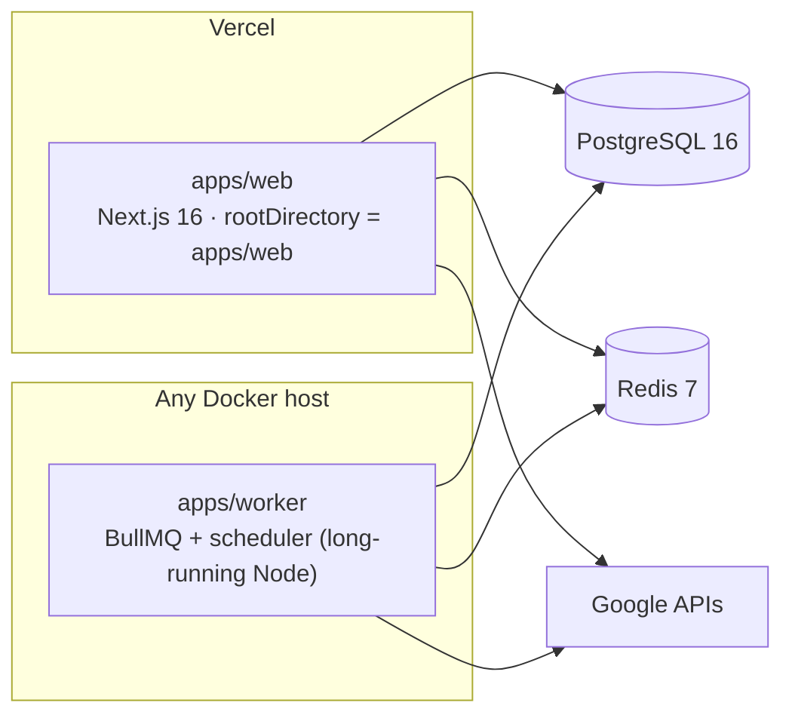

# Deployment Guide

Monorepo layout: `apps/web` (Next.js app) + `apps/worker` (BullMQ worker) +
`packages/*` (db, auth, google, jobs, shared).



## Web app (Vercel)

1. Import the repo; set **Root Directory** to `apps/web`.
2. Set every variable from `apps/web/.env.example` in the project's
   environment settings (see `docs/env-config.md`). `NEXT_PUBLIC_APP_URL`
   and `GOOGLE_REDIRECT_URI` must use the production domain.
3. Set the **Production Branch** to `main`.
4. Deploy. Vercel runs the monorepo build via Turborepo.

> ⚠️ **Migrate before you deploy code that needs new columns.**
> `pnpm db:migrate` (`prisma migrate deploy`) must run against the
> production database before (or as part of) deploying a release that
> includes migrations. Re-running it is idempotent — when in doubt, run
> it.

Self-hosting instead: `pnpm install --frozen-lockfile && pnpm db:migrate &&
pnpm build && pnpm start`.

## Worker (background sync)

The worker is a long-running Node process — it needs a persistent Redis
connection, so **do not put it on serverless/edge platforms** (Cloudflare
Workers, Vercel Functions). Any small always-on host works (a $5-class
VPS/container host is plenty to start).

```bash
docker build -f apps/worker/Dockerfile -t metricflock-worker .
docker run --env-file apps/web/.env metricflock-worker
```

Worker env needs: `DATABASE_URL`, `REDIS_URL`,
`GOOGLE_TOKEN_ENCRYPTION_KEY` (+ `_PREVIOUS` during rotation),
`GOOGLE_CLIENT_ID` / `GOOGLE_CLIENT_SECRET` for token refresh, SMTP vars
for failure alerts. No session secret. Health: `:8080/healthz` +
`/readyz` (`WORKER_HEALTH_PORT` to change the port).

The worker runs the centralized scheduler (60 s tick, Redis-locked, dedup
jobIds), refreshes expiring tokens, records integration health, and warms
caches. **Dashboards do not depend on it** — they read live from Google;
without the worker, scheduled sync simply doesn't happen and manual
"Sync now" returns `503 queue_unavailable` until Redis is configured.

## Database & Redis

- **PostgreSQL 16** — any managed Postgres works. Backups:
  `docs/operations/backup-restore.md`.
- **Redis 7** — cache, rate limits, BullMQ queues, refresh locks. Managed
  Redis (e.g. Upstash) is fine; Redis is never backed up (all state is
  reconstructible).

## Pre-launch checklist

- [ ] `pnpm db:migrate` run against the production database
- [ ] All env vars set (esp. `GOOGLE_TOKEN_ENCRYPTION_KEY` — base64 of
      32 bytes; identical everywhere the same DB is used)
- [ ] `GOOGLE_REDIRECT_URI` added in Google Cloud Console, APIs enabled
      (`docs/google-cloud-setup.md`, `docs/api-enablement.md`)
- [ ] Seed demo admin password changed / demo account removed
      (`SEED_DEMO_ADMIN_PASSWORD`; never seed production with defaults)
- [ ] OAuth consent screen submitted for Google verification before
      inviting non-test users
- [ ] `GET /api/health/ready` returns `ready`; sign-in works; a real
      Google account connects and a dashboard loads live data
- [ ] Backup cadence in place (provider PITR or `scripts/backup.sh`)

## Local development

```bash
docker compose up -d        # Postgres 16 + Redis 7
cp apps/web/.env.example apps/web/.env
pnpm install
pnpm db:migrate && pnpm db:seed
pnpm dev                    # web
pnpm worker                 # worker (separate terminal)
```

For local OAuth, add `http://localhost:3000/api/google/oauth/callback` to
the Google client's redirect URIs and set the localhost variants of
`NEXT_PUBLIC_APP_URL` / `GOOGLE_REDIRECT_URI` in `.env`. The
`GOOGLE_TOKEN_ENCRYPTION_KEY` must match production's if local dev points
at the production database.
