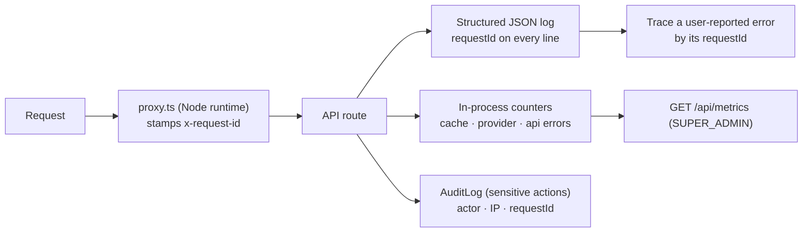

# Observability & Operations

## Request flow



## Structured logging

Both apps log one JSON object per line to stdout/stderr
(`@metricflock/shared` `createLogger`):

```json
{
  "ts": "2026-11-20T18:00:00.000Z",
  "level": "error",
  "context": "api",
  "msg": "unhandled route error",
  "requestId": "…",
  "route": "websites",
  "error": "…"
}
```

- `level`: `debug|info|warn|error` — set `LOG_LEVEL` to filter
  (default `info`). `warn`/`error` go to stderr, the rest to stdout.
- `context`: `api`, `analytics`, `discover`, `audit`, `startup`,
  `health`, `worker`, `scheduler`.
- **Correlation IDs**: the request proxy (`apps/web/src/proxy.ts`,
  Next 16 convention — runs on the Node runtime) stamps every request
  with `x-request-id` (caller's value if sane, else a UUID), echoes it
  on the response, and the API error contract returns it in the body.
  A user-reported error can be traced to its log line by requestId.

## Health endpoints

| Endpoint                | Meaning                                                                                              | Auth       |
| ----------------------- | ---------------------------------------------------------------------------------------------------- | ---------- |
| `GET /api/health`       | Liveness: process serving                                                                            | public     |
| `GET /api/health/ready` | Readiness: DB `SELECT 1` + Redis ping (`disabled` when no REDIS_URL) → 200 `ready` / 503 `not_ready` | public     |
| Worker `:8080/healthz`  | Worker liveness                                                                                      | host-local |
| Worker `:8080/readyz`   | Worker readiness: Redis + DB                                                                         | host-local |

Point your host's health check / uptime monitor at
`/api/health/ready` (web) and the worker's `/readyz`. The worker's health
port is configurable via `WORKER_HEALTH_PORT` (default 8080).

## Metrics

- `GET /api/metrics` (SUPER_ADMIN session required): in-process
  counters (cache hit/miss/stale/error, provider errors incl. quota,
  API internal/Prisma errors), cache hit rate, 24h sync success rate
  by status, DLQ depth + oldest failed job, per-queue BullMQ counts
  (waiting/delayed/active/failed), uptime.
- Worker `:8080/metrics`: worker counters (jobs succeeded/failed per
  queue, terminal failures, scheduler tick failures, realtime
  backpressure events) + uptime.

In-process counters reset on restart by design; durable numbers
(sync success, DLQ) are computed from `AnalyticsSyncJob` rows at read
time.

## Dead-letter handling (failed sync jobs)

Terminally failed jobs stay as `FAILED` rows with payload + error for
30 days (then pruned by the scheduler).

- List: `GET /api/sync/failed` (SUPER_ADMIN, paginated).
- Requeue: `POST /api/sync/requeue` `{"jobId":"<row id>"}` — re-enqueues
  the retained payload, flips the row to `PENDING`, writes an audit
  entry (`sync.job.requeued`).
- The same view is available in the UI under **Sync jobs** (SUPER_ADMIN).

## Alerting

- A sync job that fails after all retries emails every SUPER_ADMIN of
  the owning organization (worker, best-effort; needs SMTP configured
  — without it the mailer logs to console).
- Recommended external alerts on top of the endpoints above:
  - `/api/health/ready` not 200 for > 2 min → page.
  - `dlq.failed24h` increasing / `sync24h.successRate` < 0.9 → investigate.
  - Any queue's `waiting` growing across two checks 10 min apart → worker down or backlogged.
  - `provider.quota_error` counter rising → Google quota pressure (check sync intervals).

## Backups

See `docs/operations/backup-restore.md` — Postgres only, daily
cadence, CI-tested restore drill.
