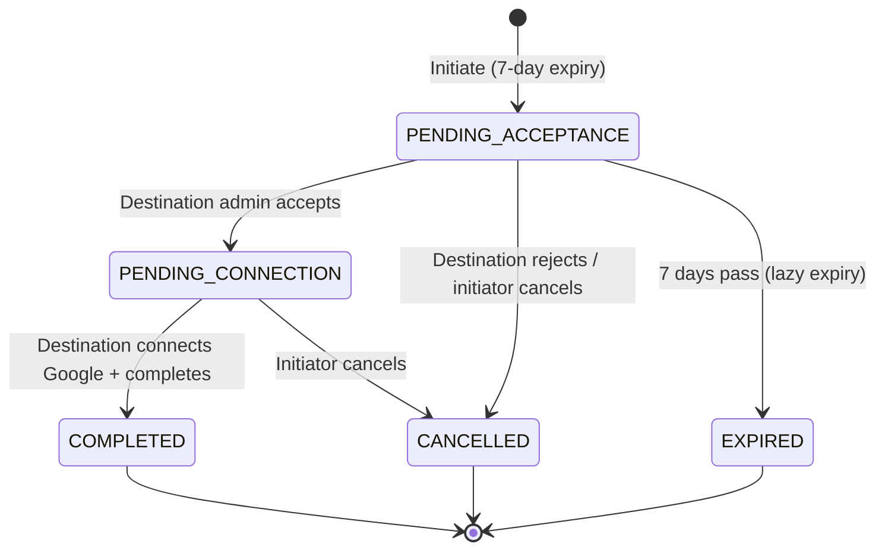

# Ownership Transfer Guide

Website transfers are **two-sided**: the destination team must accept, and
the website only moves once the destination has its own active Google
connection — so a site is never handed over without working data access.
OAuth tokens are **never** transferred; the new team connects its own
Google account.

## State machine

## Flow

| Step     | Endpoint                                                 | Who                                         | What happens                                                                                                                                       |
| -------- | -------------------------------------------------------- | ------------------------------------------- | -------------------------------------------------------------------------------------------------------------------------------------------------- |
| Initiate | `POST /api/websites/[id]/transfer` (`toTeamId` + reason) | Source org SUPER_ADMIN (`website.transfer`) | Creates a `PENDING_ACCEPTANCE` transfer (7-day expiry). Nothing moves yet                                                                          |
| Accept   | `POST /api/transfers/[id]/accept`                        | Destination team admin                      | → `PENDING_CONNECTION`                                                                                                                             |
| Reject   | `POST /api/transfers/[id]/reject`                        | Destination team admin                      | → `CANCELLED`                                                                                                                                      |
| Cancel   | `POST /api/transfers/[id]/cancel`                        | Initiator                                   | → `CANCELLED`                                                                                                                                      |
| Complete | `POST /api/transfers/[id]/complete`                      | Destination team admin                      | Requires an **ACTIVE** Google connection on the destination team. Moves `teamId`, clears old member assignments and old integrations → `COMPLETED` |

## Rules

- **Only completion moves the website.** Until then it stays fully with the
  source team; a rejected/cancelled/expired transfer changes nothing.
- **One open transfer per website** — enforced by a partial unique index,
  so a website can't be promised to two destinations at once.
- **Expiry is lazy** — a `PENDING_ACCEPTANCE` transfer past its 7-day
  deadline flips to `EXPIRED` the next time it's read or acted on.
- **Tokens never move.** The destination connects its own Google account,
  discovers and maps properties fresh (`docs/property-mapping.md`).
- **Access ends immediately on completion** — old team members lose access
  via server-side checks; historical reports and the audit trail stay
  attached to the website.
- Every step is audit-logged with actor, IP and requestId.

## After completion

1. Destination team: connect Google (if not already), **Discover**, **map**
   the properties to the website.
2. Confirm the website dashboard loads live data and integration health is
   green.

## Related

- `docs/website-management.md` — website lifecycle
- `docs/property-mapping.md` — mapping after a transfer
- `docs/security/overview.md` — transfer integrity guarantees
