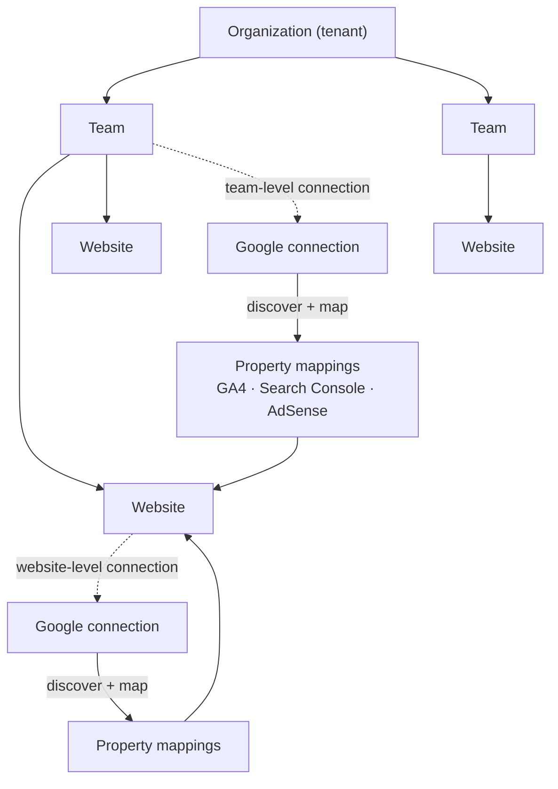

# Product Overview

MetricFlock manages Google analytics and publisher data for portfolios of
100+ websites, organized into teams, with website ownership transfers
(flipping) as a first-class workflow.

## Core concepts

- **Organization** — the tenant. Users, teams, websites, connections and
  audit history all live inside one organization. Every query is scoped to
  the caller's organization; foreign ids return 404, never data.
- **Team** — a group of websites + members. Team admins manage their team's
  websites and connections.
- **Website** — a site being tracked. Belongs to exactly one team; members
  can be assigned to individual websites. New websites start as
  `PENDING_SETUP` and flip to `ACTIVE` automatically on their first property
  mapping.
- **Google connection** — an OAuth grant owned by a team or a website.
  Properties (GA4, Search Console sites, AdSense accounts) are discovered
  from it and **mapped** to websites; fetches always use the connection the
  mapping was made under. Resolution order: website connection first, then
  team connection. Credentials are never merged.
- **Transfer** — moving a website between teams is two-sided: the
  destination team accepts, connects its own Google account, and only then
  does ownership move (old assignments/integrations are cleared). See
  `docs/ownership-transfer.md`.

## Data sources

All data comes from the real Google APIs via the `googleapis` REST client
(`packages/google`). There is no mock data anywhere: when a website has no
connection or no mapped property, the API says so explicitly
(`not_connected` / `missing_data`); numbers are never invented.

| Source             | What MetricFlock reads                                                                |
| ------------------ | ------------------------------------------------------------------------------------- |
| **GA4**            | Realtime totals + platform breakdown, historical summary, top pages, audience, events |
| **Search Console** | Clicks, impressions, CTR, impression-weighted average position, top queries & pages   |
| **AdSense**        | Estimated earnings, page views, impressions, clicks, CTR, CPC, page/impression RPM    |
| **Ad Manager**     | Optional ad reporting (`GOOGLE_AD_MANAGER_ENABLED=true`)                              |

Analytics correctness rules (dimension-less totals, impression-weighted
position, sampling caveats surfaced in the UI) are documented in the audit
(DATA-1…DATA-11) and implemented in `packages/google`.

## Live reads + background sync

Dashboards read **live** from Google through the web app. A BullMQ worker +
scheduler additionally keep stored snapshots fresh on configurable cadences
(`packages/jobs/src/scheduler.ts`):

| Job            | Default interval | Env var                       |
| -------------- | ---------------- | ----------------------------- |
| GA4 realtime   | 300 s            | `SYNC_GA4_REALTIME_SECONDS`   |
| GA4 historical | 45 min           | `SYNC_GA4_HISTORICAL_MINUTES` |
| Search Console | 8 h              | `SYNC_SEARCH_CONSOLE_HOURS`   |
| AdSense        | 3 h              | `SYNC_ADSENSE_HOURS`          |
| Ad Manager     | 3 h              | `SYNC_AD_MANAGER_HOURS`       |
| Health checks  | 1 h              | `SYNC_HEALTH_CHECK_HOURS`     |

Realtime jobs are coalesced and backpressured; OAuth tokens refresh ahead of
expiry. Terminal failures email org SUPER_ADMINs and land in a dead-letter
view with one-click requeue (`docs/operations/observability.md`). The worker
is optional for dashboards — without Redis, manual "Sync now" returns `503
queue_unavailable` and everything else keeps working.

## Roles

`SUPER_ADMIN` (whole org), `TEAM_ADMIN` (own team), `TEAM_MEMBER` (assigned
websites) — 17 granular permissions in `packages/auth/src/permissions.ts`.
New users join via invite (see `docs/team-management.md`); self sign-ups get
their own organization.

## Where to go next

- Connect Google: `docs/google-cloud-setup.md`, `docs/api-enablement.md`,
  `docs/oauth-guide.md`
- Map properties: `docs/property-mapping.md`
- Teams & websites: `docs/team-management.md`, `docs/website-management.md`
- Transfers: `docs/ownership-transfer.md`
- Security model: `docs/security/overview.md`
