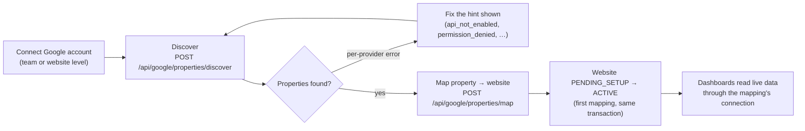

# Property Mapping Guide

A **mapping** links a discovered Google property (GA4 property, Search
Console site, AdSense account) to a website, under the connection that
discovered it. Only mapped properties return data.

## Flow

1. **Connect** a Google account from `/integrations` — team-level (shared by
   the team's websites) or website-level (dedicated to one website). See
   `docs/oauth-guide.md`.
2. **Discover** — `POST /api/google/properties/discover` lists everything
   the account can access: GA4 properties (Analytics Admin API), Search
   Console sites, AdSense accounts. Failures are reported **per provider**
   (`api_not_enabled`, `permission_denied`, `unauthorized`,
   `provider_error`) with a hint in the UI — see `docs/api-enablement.md`.
3. **Map** — `POST /api/google/properties/map` with `provider` +
   `externalId` (and optionally `connectionId` when several connections
   could match). The server verifies the property was actually discovered
   under a connection visible to you before saving.

## Rules

- **One primary mapping per provider per website** — enforced by a partial
  unique index. Mapping a new primary demotes the old one in the same
  transaction.
- **First mapping activates the website** — a website still in
  `PENDING_SETUP` flips to `ACTIVE` in the mapping transaction. Manually
  set `DISCONNECTED` / `ARCHIVED` statuses are never touched.
- **Resolution order** — website-level connection first, then team-level.
  Fetches always use the connection the mapping was made under;
  credentials are never merged across connections.
- **No mapping, no numbers** — unmapped websites return
  `status: "missing_data"`; websites without any connection return
  `status: "not_connected"`. MetricFlock never invents metrics.

## Map errors

| Error                     | HTTP | Meaning                                                                                                                        |
| ------------------------- | ---- | ------------------------------------------------------------------------------------------------------------------------------ |
| `property_not_discovered` | 400  | The property isn't in the discovered list for any visible connection — run Discover again, or connect the account that owns it |
| `ambiguous_property`      | 400  | Several connections discovered the same property — pass `connectionId` to pick one                                             |

## Related

- `docs/oauth-guide.md` — connecting accounts
- `docs/api-enablement.md` — discovery error codes and fixes
- `docs/website-management.md` — website lifecycle
