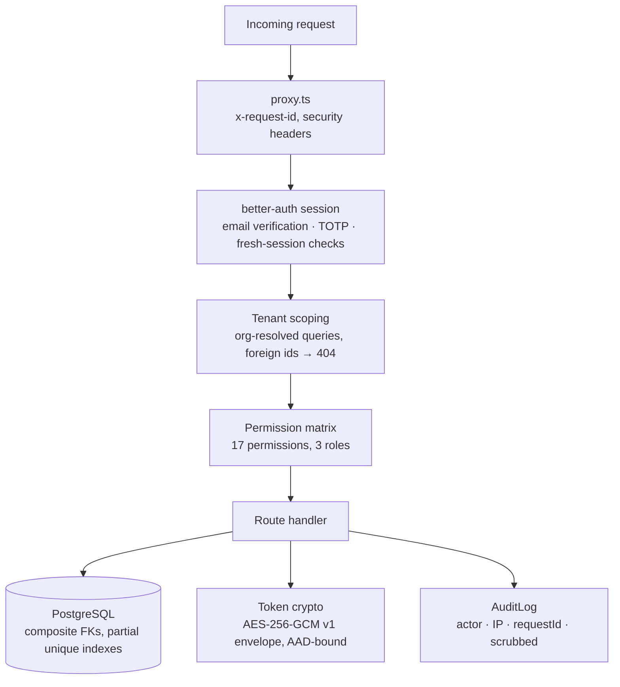

# Security Overview

How MetricFlock protects accounts, tenants and Google credentials.
Findings and remediation history: `docs/audits/PRODUCTION_READINESS_AUDIT.md`
(93 findings, 2026-11-20) and the hardening stages that closed them.

## Authentication

- better-auth with Prisma adapter. Email + password (≥12 chars,
  scrypt), **email verification required** before sign-in, Google
  sign-in, **TOTP two-factor** with backup codes.
- Password reset via emailed token; a reset **revokes all sessions**.
- Users can list/revoke their sessions at `/settings/security`;
  sensitive operations require a fresh session (15 min).
- Mass-assignment is closed: `role` and `organizationId` are
  server-owned fields (`input: false` + update hook rejection);
  organizations are always provisioned server-side at sign-up.
- Auth endpoints are rate-limited (better-auth defaults + Redis
  limiter on OAuth connect/callback).

## Tenancy & authorization

- Every resource belongs to an organization. Route handlers resolve
  resources **through the caller's organization** — foreign ids
  return 404, never data.
- Roles: `SUPER_ADMIN`, `TEAM_ADMIN`, `TEAM_MEMBER` with a permission
  matrix (`packages/auth/src/permissions.ts`); team admins are
  `TeamMember.isAdmin` within their team; website assignments narrow
  member visibility further.
- Google connections are visible to org admins and to members of the
  owning team (or assignees of the owning website) — enforced in
  `tenant.ts` (`connectionVisibilityWhere` / `assertConnectionVisible`).
- The last SUPER_ADMIN of an org cannot be demoted/removed.
- Cross-tenant isolation is regression-tested in CI
  (`scripts/smoke-test.sh` IDOR matrix: 9 probes + list scoping).

## Google OAuth & tokens

- Connect flow: server-persisted, single-use, session-bound state
  with **PKCE (S256)**; the connection owner (team/website) is
  validated against the caller's org at connect **and** callback.
  See `docs/oauth-guide.md`.
- Tokens encrypted at rest with **AES-256-GCM**, versioned envelope
  `v1:<keyId>:…`, AAD bound to the connection identity, auth tag
  length pinned to 16 bytes; previous-key rotation window + lazy
  re-encryption (`docs/token-encryption-rotation.md`).
- Refresh is serialized per connection (Redis lock); only a
  structured `invalid_grant` marks a connection REVOKED, and the
  revocation is audit-logged.

## Data integrity

- Typed owner FKs on connections (composite same-org FKs), composite
  FK `Website.team`, single-primary-mapping partial unique index,
  one-open-transfer-per-website partial unique index.
- Ownership transfers are two-sided (destination accepts, then
  connects Google, then completion moves the website) — see
  `docs/ownership-transfer.md`.

## Audit & observability

- `AuditLog` records sign-ins/sign-ups, role changes, transfers,
  disconnects, sync requeues, token revocations — with actor, IP and
  requestId. Credential-shaped keys are scrubbed recursively before
  storage. See `docs/operations/observability.md`.

## Headers & cookies

- CSP, HSTS, X-Frame-Options DENY, nosniff, Referrer-Policy,
  Permissions-Policy on every response (`apps/web/next.config.ts`).
- Session cookies are httpOnly via better-auth; state-changing auth
  calls pass better-auth's CSRF origin check.

## Supply chain & CI security

- **GitHub Actions pinned by commit SHA** (never moving tags) —
  Dependabot keeps the pins current with grouped, weekly PRs.
- **gitleaks** secret scanning on every CI run (`.gitleaks.toml`
  allowlists only documented CI dummy values).
- **CodeQL** + **Semgrep** (`p/typescript`) SAST on every push.
- `pnpm audit` gate in CI and a weekly scheduled audit.
- `minimumReleaseAge: 1440` in `pnpm-workspace.yaml` refuses package
  versions published <24 h ago (lockfile installs unaffected);
  pnpm's postinstall allowlist (`allowBuilds`) gates build scripts.
- Latest **stable** versions only — no beta/RC dependencies.

## Reporting

Vulnerability reports: see `SECURITY.md` at the repo root.
