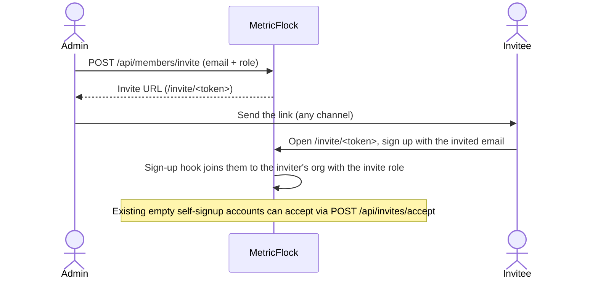

# Team Management Guide

Teams group websites and members inside an organization. Org-level
membership (who belongs to the organization at all, and with which role) is
managed separately from team membership.

## Roles

| Role          | Scope              | Highlights                                                   |
| ------------- | ------------------ | ------------------------------------------------------------ |
| `SUPER_ADMIN` | Whole organization | Everything, incl. transfers, audit log, org settings         |
| `TEAM_ADMIN`  | Own team           | Manage team websites/members/connections, view all analytics |
| `TEAM_MEMBER` | Assigned websites  | View analytics for assigned websites only                    |

Full permission matrix: `packages/auth/src/permissions.ts` (17 permissions).

## Teams

| Action                   | Endpoint                         | Permission       | Notes                                                                                                                                                        |
| ------------------------ | -------------------------------- | ---------------- | ------------------------------------------------------------------------------------------------------------------------------------------------------------ |
| Create team              | `POST /api/teams`                | `team.manage`    | Name + slug (auto-slugged in the UI)                                                                                                                         |
| Edit team                | `PATCH /api/teams/[id]`          | `team.manage`    |                                                                                                                                                              |
| Delete team              | `DELETE /api/teams/[id]`         | `team.manage`    | `409 team_has_websites` (with count) while websites remain — move or delete them first. Members and team connections cascade. Audit-logged as `team.deleted` |
| Add/remove team member   | `POST /api/teams/[id]/members`   | `team.manage`    | `isAdmin` flag marks team admins within the team                                                                                                             |
| Assign member to website | `POST /api/websites/[id]/assign` | `website.assign` | Members only see websites assigned to them                                                                                                                   |

## Inviting people to the organization

Self sign-ups always get their **own** organization (as its SUPER_ADMIN).
To bring someone into _your_ organization, invite them:

- `POST /api/members/invite` (`member.manage`) creates an invite and
  returns its URL. Roles grantable by invite: `TEAM_ADMIN`, `TEAM_MEMBER` —
  **SUPER_ADMIN is never grantable by invite**.
- `DELETE /api/members/invite/[id]` revokes a pending invite.
- Invite tokens are stored as SHA-256 hashes only.
- If the invitee already has an account (an empty self-signup shell org),
  `POST /api/invites/accept` moves them into the inviting org; accounts
  that already own data get `409` instead of a silent merge.

## Changing roles

`PATCH /api/members/[id]` (`member.manage`):

- You cannot change your own role (`400`).
- The **last SUPER_ADMIN** of an organization cannot be demoted or removed
  (`409`) — promote someone else first.
- Role changes are audit-logged with the actor's IP.

## Visibility rules

- Team members only see websites explicitly assigned to them; they cannot
  manage teams, connections, or transfers.
- Google connections are visible to org admins, members of the owning team,
  and assignees of the owning website — enforced server-side
  (`tenant.ts`: `connectionVisibilityWhere` / `assertConnectionVisible`).
- Everything is organization-scoped: ids from another org return 404.

## Related

- `docs/website-management.md` — websites and assignments
- `docs/security/overview.md` — tenancy and authorization model
