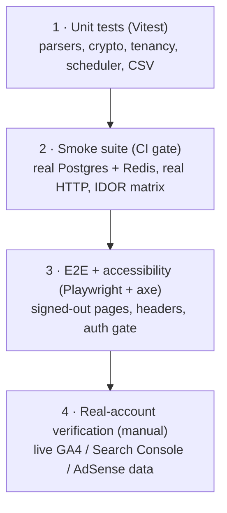

# Testing

Four layers, in increasing order of realism. **No layer mocks present
themselves as live Google verification** — real Google data is only ever
proven by connecting a real account (see
`apps/web/tests/integration/README.md` for that manual procedure).



## 1. Unit tests (Vitest)

```bash
pnpm test            # turbo: all packages
pnpm test:coverage   # with v8 coverage + thresholds
```

Pure-logic coverage: GA4/Search Console/AdSense/Ad Manager parsers,
token crypto, OAuth state, tenant policy, sync engine, scheduler
planning, CSV, pagination, API error contract, audit scrubbing,
structured logger/metrics. Coverage thresholds (90/80/90/90) guard
the tested modules — see `apps/web/vitest.config.ts`.

## 2. Smoke / integration suite (CI gate)

```bash
pnpm build && pnpm smoke   # needs real Postgres + Redis
```

`scripts/smoke-test.sh` boots the production build against real
Postgres 16 + Redis 7 and drives real HTTP: sign-in, auth security
regressions (mass assignment, escalation, cross-org probes), OAuth
state matrix (forged/expired/replayed state, wrong session, PKCE),
two-sided transfers, password reset with session revocation, TOTP
sign-in challenge, health / metrics / DLQ requeue, team & website
deletion, status auto-flip on first mapping, a **cross-tenant IDOR
matrix**, and a **backup → restore drill**. This is the suite that
proves route-level authorization against the real database. It runs
on every push to `main` and every PR in CI.

## 3. E2E + accessibility (Playwright + axe)

```bash
pnpm --filter @metricflock/web build
pnpm --filter @metricflock/web test:e2e
```

Signed-out pages: axe scan (zero critical/serious violations),
security-header assertions in a real browser, auth-gate redirect.
Authenticated flows are covered by layer 2.

## 4. Real-account verification (manual)

Connect a real Google account under Integrations, map properties,
and confirm dashboards return live data. The only proof that counts
for GA4/Search Console/AdSense correctness. Status: Search Console
live data verified in production 2026-11-21; GA4 (REST Data API
client) and AdSense earnings verification in progress.

## Lint & boundaries

`pnpm lint` runs ESLint (JS/config files) plus
`scripts/check-boundaries.sh` — grep-based package-boundary checks
(Google SDK only in `packages/google`, Prisma client only in
`packages/db`, no cross-package relative imports, no `console.*` in
src). typescript-eslint does not yet support TypeScript 7, so the
ESLint TS rules are dormant until upstream ships support.

## CI workflows

| Workflow                    | Trigger             | Checks                                                                                          |
| --------------------------- | ------------------- | ----------------------------------------------------------------------------------------------- |
| `ci.yml`                    | push to `main`, PRs | gitleaks, `pnpm audit`, format, typecheck, lint, unit tests + coverage, build, smoke suite, e2e |
| `codeql.yml`                | push/PR + schedule  | CodeQL static analysis                                                                          |
| `security-audit.yml`        | push/PR + weekly    | Semgrep `p/typescript` over `apps/` + `packages/`                                               |
| `lint.yml`                  | push/PR             | Markdown trailing whitespace, YAML validity                                                     |
| `scheduled-maintenance.yml` | weekly + manual     | `pnpm audit`                                                                                    |
| `label.yml`                 | PRs                 | Auto-label by changed paths                                                                     |
| `release.yml`               | `v*` tags           | GitHub release with generated notes                                                             |

All actions are pinned by commit SHA; Dependabot keeps them current.
