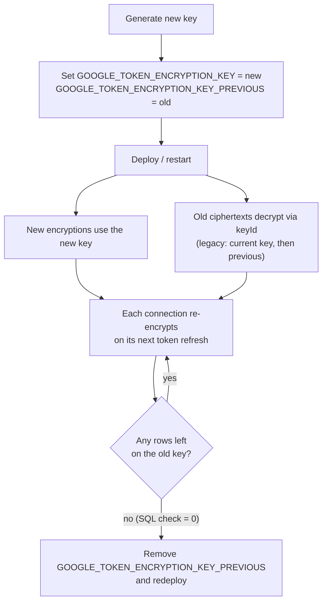

# Token Encryption Key Rotation

Google OAuth tokens are encrypted at rest with AES-256-GCM. Every
ciphertext carries a versioned envelope:

```
v1:<keyId>:<base64(iv|tag|data)>
```

`keyId` is the first 8 hex chars of `SHA-256(key)` — a non-secret
identifier that tells decrypt which key to use. Ciphertexts are also
bound to their connection identity via AAD
(`mf-conn:<orgId>:<ownerType>:<ownerId>:<googleAccountEmail>`), so a
ciphertext cannot be transplanted between connection rows. The auth tag
length is pinned to 16 bytes on both encrypt and decrypt. Legacy
ciphertexts (no `v1:` prefix, no AAD) still decrypt and are re-encrypted
lazily the next time their connection refreshes.

## When to rotate

- The current key may have leaked (repo/log/backup exposure).
- Routine hygiene (e.g. annually, or when team members with access leave).

## Rotation flow



## Rotation procedure

1. Generate a new key:
   `node -e "console.log(require('crypto').randomBytes(32).toString('base64'))"`
2. Set **both** env vars (locally in `apps/web/.env`, and in the Vercel
   project for production + preview):
   - `GOOGLE_TOKEN_ENCRYPTION_KEY` = the **new** key
   - `GOOGLE_TOKEN_ENCRYPTION_KEY_PREVIOUS` = the **old** key
3. Deploy / restart. From this point:
   - New encryptions use the new key.
   - Existing ciphertexts decrypt with whichever key their `keyId`
     names (legacy rows: current key first, then previous).
   - Each connection's tokens are re-encrypted under the new key the
     next time they are refreshed.
4. Wait until every active connection has refreshed at least once
   (access tokens refresh within ~1 hour of use; idle connections
   re-encrypt on their next sync). To verify none remain on the old
   key, check for rows whose ciphertext is legacy or carries the old
   keyId:
   `SELECT count(*) FROM "GoogleConnection" WHERE "encryptedRefreshToken" NOT LIKE 'v1:<newKeyId>:%' AND "encryptedRefreshToken" <> '';`
5. Remove `GOOGLE_TOKEN_ENCRYPTION_KEY_PREVIOUS` and redeploy. Any row
   still on the old key after this step becomes undecryptable
   (`TOKEN_KEY_UNKNOWN`) and its owner must reconnect Google — so do
   not skip step 4's check.

## Notes

- Never commit keys to the repo; they live only in env config.
- The key must be **identical** in every environment that touches the
  same database (local dev against a production DB included) — a
  different key cannot decrypt existing tokens.
- Rotating does not revoke Google grants; it only re-wraps stored
  tokens. If a _token_ leaked, disconnect the connection instead
  (revokes at Google and clears stored tokens).
- `SESSION_SECRET` is separate: it signs OAuth state values. Rotating
  it invalidates in-flight connect attempts (10-minute lifetime) and
  is safe at any time.
