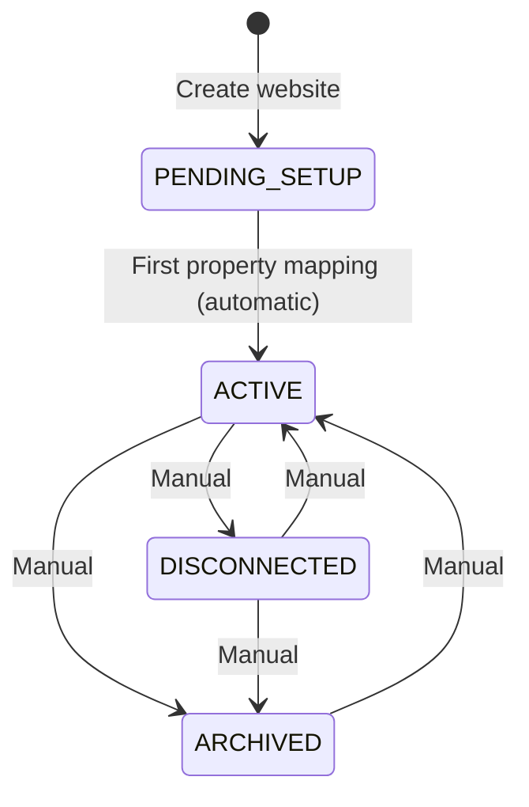

# Website Management Guide

A website belongs to exactly one team. Members see only the websites
assigned to them.

## Lifecycle

Client-settable statuses: `ACTIVE`, `PENDING_SETUP`, `DISCONNECTED`,
`ARCHIVED`. (`TRANSFER_PENDING` and `SOLD` exist in the database enum for
legacy rows but are no longer settable through the API — ownership changes
go through the transfer workflow, `docs/ownership-transfer.md`.)

## Actions

| Action             | Endpoint                           | Permission         | Notes                                                                                                                     |
| ------------------ | ---------------------------------- | ------------------ | ------------------------------------------------------------------------------------------------------------------------- |
| Create             | `POST /api/websites`               | `website.manage`   | Name, domain, URL, team (required), status, purchase/sale price + dates, notes. Defaults to `PENDING_SETUP`               |
| Edit               | `PATCH /api/websites/[id]`         | `website.manage`   | Includes moving to another team via `teamId` (same-org only)                                                              |
| Assign member      | `POST /api/websites/[id]/assign`   | `website.assign`   | Grants a team member visibility of this website                                                                           |
| Delete             | `DELETE /api/websites/[id]`        | `website.manage`   | Cascades integrations, assignments, transfers, sync jobs and website-level connections. Audit-logged as `website.deleted` |
| Transfer ownership | `POST /api/websites/[id]/transfer` | `website.transfer` | Starts the two-sided transfer flow — see `docs/ownership-transfer.md`                                                     |
| Sync now           | `POST /api/sync`                   | `website.manage`   | Enqueues an on-demand sync; `503 queue_unavailable` when Redis isn't configured                                           |

## Connecting data

1. `/integrations` → connect a Google account (team-level or
   website-level).
2. **Discover** properties, then **map** them to the website
   (`docs/property-mapping.md`). The first mapping flips the website from
   `PENDING_SETUP` to `ACTIVE` automatically.
3. Open the website page — GA4, Search Console and AdSense cards read live
   data through the mapping's connection, with CSV export.

## Health

Integration health (last success, last error per provider) is tracked in
`IntegrationHealth` rows and shown on `/integrations` and the website page.
Provider failures carry classified codes (`api_not_enabled`,
`permission_denied`, `unauthorized`, `google_quota_exceeded`,
`invalid_request`, `provider_error`) — see `docs/troubleshooting.md`.

## Related

- `docs/property-mapping.md` — discovery and mapping
- `docs/team-management.md` — teams, members, assignments
- `docs/ownership-transfer.md` — moving a website to another team/org
